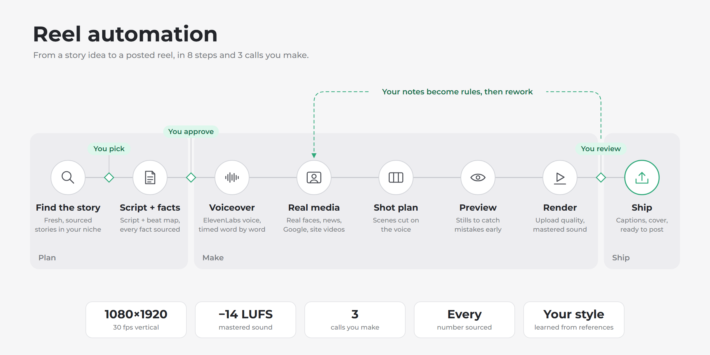

# Reel automation

Agent-driven faceless reels for Instagram, TikTok and YouTube Shorts. You
pick a story and approve the script; a coding agent (Claude Code, Codex,
Cursor…) does the rest: voiceover, real receipts, motion scenes, captions,
music and a mastered 1080×1920 render.



## What you get
- **Your style, learned from your references.** On first run the agent
  measures 5–10 reels you like (pace, cuts, look, captions) and writes a
  style pack it follows for every reel.
- **Real receipts, not just graphics.** News pages, Google searches and company
  sites captured as screenshots or screen recordings, zoomed in with a
  highlighter sweep on the key line. Real people's photos on story cards.
- **A scene kit.** Browser receipts, story cards, logo lockups, big numbers,
  growth charts, robots-and-people stages, word-by-word statements, follow
  cards: see [docs/SCENES.md](docs/SCENES.md).
- **Cut on the voice.** ElevenLabs voiceover, Whisper word timings, every
  scene starting on a spoken phrase, captions that pop in word by word.
- **Finished audio and picture.** Music levelled about 13 LU under the voice,
  mastered to −14 LUFS, rendered at upload quality (lossless frames, BT.709).
- **Facts you can defend.** Every number on screen traces to a fact ledger
  with its source.

## Start
1. Clone the repo and open the folder in Claude Code, Codex or another coding
   agent.
2. Say: **"set me up"**. The agent follows [AGENTS.md](AGENTS.md):
   - checks your machine and installs what's missing (with your OK)
   - asks about your channel
   - asks for 5–10 reference reels and learns your style from them
   - has you connect the **ElevenLabs MCP connector** and pick a voice
   - helps you collect royalty-free music and sound effects
3. When you want a reel, say so. It finds story ideas, writes the script for
   your approval (with the credit cost), then builds, renders and packages it.

## Requirements
- Node.js 18+, Python 3.10+, ffmpeg on your PATH
- `npm install`, `pip install -r requirements.txt`, `npx playwright install chromium`
- An ElevenLabs account (the voiceover uses your credits; roughly one credit per character)
- `python scripts/doctor.py` checks everything

## Manual commands
```
python scripts/new_job.py my-reel --topic "..."
python scripts/voiceover.py prepare my-reel --tempo 1.08
python scripts/compile_shot_plan.py my-reel
python scripts/validate_job.py my-reel
python scripts/register_beats.py
python scripts/render_job.py my-reel
python scripts/publish_reel.py my-reel
npm run studio                      # preview; "kit-demo" shows every scene
```

## What's not included, and why
- **Music and sound effects:** their licences don't allow redistribution.
  Add your own royalty-free files (see `public/music/README.md`).
- **Reference reels:** you bring your own; they stay on your machine.
- **Your settings, style pack, jobs and renders** are git-ignored, so your
  fork never leaks them.

## Credits
Created by [@usyedddd](https://github.com/usyedddd). If you use, fork, adapt
or sell this, keep the MIT copyright notice (the licence requires it) and
credit the original project.

## Licences and responsibility
- Code: [MIT](LICENSE), copyright [@usyedddd](https://github.com/usyedddd).
- [Remotion](https://www.remotion.dev/license) has its own licence: free for
  individuals and small teams; larger companies need a company licence.
- You're responsible for the media in your reels: use material you have the
  right to use, credit your sources, follow each platform's rules and
  ElevenLabs' terms. The agent is told never to get around bot walls or
  invent facts. Keep it that way.
